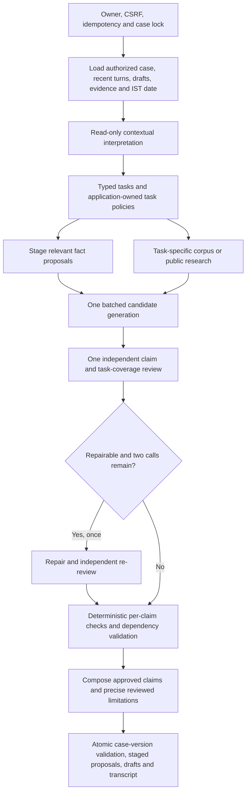

# Task-scoped evidence, review and publication

Implemented 6 November 2026. This increment was tested offline. No live OpenAI evaluation was run and no API credit was used for testing it.

Subsequent user-authorized validation: [three real-model responses](../evals/reports/three-public-prompts-20261106T172240Z.md) were collected after implementation. All three were partial, not acceptance passes. The four-call test cap left web research deferred; false preparation-content blocking and two source-span interpreter failures remain. No automatic paid rerun was made.

## Problems addressed

The production graph previously generated one response envelope and replaced the whole answer when any substantive review failed. Public search also reused the consumer ingestion URL walker, and non-consumer tasks could reach consumer retrieval. Citation identity depended on generated display text. Intake permission and fact investigation were conflated, and model-call accounting incorrectly depended on whether the provider returned usage metadata.

## Execution flow

The existing LangGraph, SQLite, Chroma and React architecture remains. `triage` enables the new unit protocol on every normal application turn. Legacy whole-envelope methods remain for older direct-call compatibility tests; they are not the production publication path after interpretation. No provider, framework or dependency was added.

## Contracts and interfaces

| Component | Responsibility |
|---|---|
| `routing/task_context.py` | Immutable task policy, corpus permissions, conservative research reuse and budget reservation |
| `answers/contracts.py` | Candidate units/claims, independent claim findings and task completion assessments, engine-created verified units |
| `answers/evidence.py` | Turn-local canonical evidence IDs, text hashes, case/corpus versions and display citations |
| `answers/pipeline.py` | Injectable batched generation/review, bounded context, one repair and case-review decision |
| `answers/verification.py` | Evidence identity, applicability, legal eligibility, dates, real tool claims, severity, review freshness and dependency DAG |
| `answers/composition.py` | Deterministic composition; cannot introduce generated assertions |
| `CaseStateManager` / `Database.save_memory` | Trusted owner/case scope, provenance, immutable event history, CAS transaction and staging |

Candidates and reviewers cannot select another owner/case or grant filing permission. Specialist behavior is driven by task contracts and existing policies rather than a class per platform. Dependencies are injected at the interpreter, model, fetcher and repository boundaries for tests. Responsibilities remain separated: interpretation, applicability, execution, semantic review, persistence and presentation.

## Publication boundary

Every claim needs a unique identity and one independent semantic review. Factual correspondence references authorized reports/documents; those references do not prove the underlying allegations. Legal, procedural and safety conclusions require appropriate public evidence. Unknown/unexposed IDs, inapplicable corpora, unverified source origins, undeclared consequential filing advice, mismatched eligibility evidence, unsupported statutory clocks and invalid tool claims block the affected content. Model agreement does not establish legal correctness.

Citation labels come from the registry; the model supplies IDs only. A valid ID with the wrong meaning still fails semantic review. Sources shown with an answer are limited to the passages supporting its published claims. Unknown jurisdiction, publication and effective dates remain unknown.

Critical, major and moderate findings block affected claims and dependent claims. Minor/advisory presentation findings alone do not. Turn-wide privacy/safety findings remain blocking when the problem genuinely affects the whole turn. Missing, blocked and cyclic dependencies fail closed. A document is exportable only when every declared document claim is approved; the generator's unreviewed title is replaced by an application-owned title.

Task completion is reviewed separately from sentence support. `supported`, `partial`, `deferred` and `blocked` are derived by the engine. A reviewed limitation/question can be shown without pretending that the underlying research request was answered. Unreviewed `unresolved` strings and reviewer diagnostics never render as chat text. Precise limitations and questions must themselves be claims and receive review.

Fresh reviews bind to the candidate batch, evidence, runtime/task context, memory and draft contract. Previously approved unchanged claims can survive a failed repair review using turn-local content/evidence/task/version signatures. Deterministic checks run again. Changed evidence/text or a fresh contrary verdict cannot borrow an old approval. The cache is cleared on every turn and is never shared between cases or owners.

## Research and domain boundaries

General public discovery no longer uses the consumer ingestion allowlist. Ingestion remains restricted. Public search, safe fetching, origin assessment and legal applicability are distinct stages. Diagnostics retain URL hashes/hosts, stage counts, rejection reasons and exception types rather than upstream error strings or credentials. A relevant fetched candidate is not a legally applicable source. Government origin is not verified filing eligibility.

Non-consumer tasks cannot invoke the consumer vector collection, including for urgent fraud. Consumer judgments are excluded from ordinary retail retrieval unless a suitable comparison workflow is supplied. That comparison workflow is not implemented; this is a conservative exclusion, not a comprehensive judgment-applicability classifier.

Factual drafting/checklists can use user reports without an additional search. Related research is reused only for matching domain, explicit case association and identical issue context; this is intentionally conservative. Generation reserves review capacity and repair reserves re-review capacity. Intake calls count even when usage metadata is absent. There is no promise that the configured budget can cover every multi-domain request.

## Case integrity

`requires_case_update` is a proposal, not permission and not the sole extraction gate. Relevant legal task excerpts can be investigated and staged independently. Committed updates still require case association, domain consistency, provenance, semantic case-diff review and the atomic base-version check. Unrelated/general requests cannot rewrite existing memory, summaries or user-edited drafts. Failed interpretation is diagnostic and cannot authorize a case commit.

The additive `staged_case_updates` table is owner-isolated through its conversation, transactionally written, and deleted by conversation cascade. The case drawer presents staged details separately and labels stale proposals. It does not silently apply them. Currently users restate/correct details in chat; there is no one-click proposal-acceptance UI. Existing conversation/files/checkpoint deletion and owner protections remain.

## Validation and limits

See [executed report](../evals/reports/answer-units-2026-11-06.md). The original five live runs did not retain generation candidates, so the new failure reconstructions are explicitly synthetic, not recorded-model replays. The live runner now records candidate units, independent reviews and engine outcomes for future explicitly authorized runs.

Semantic routing, review quality, task splitting and live latency remain unverified for v2. A malformed whole generation/review contract can still lead to explained deferral; no unsupported output is salvaged by guessing. Source origin recognition is conservative and does not establish every company's official identity. Non-consumer filing eligibility, case-specific statutory deadline policies, authenticated platform forms, broad judgment applicability, community outcome statistics and qualified lawyer review remain pending. No external send/file/sign capability exists.
