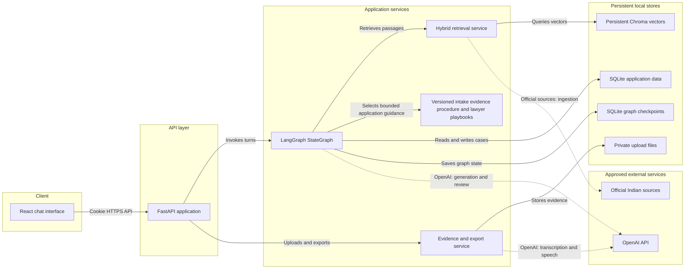

# Nyay Saathi architecture

The current production publication boundary is documented in [task-scoped answer units](answer-unit-publication.md). It supersedes the older whole-response gate: independent supported claims survive another task's failure; case commits remain separately authorized and version-checked.

Nyay Saathi is a local-first two-service application. FastAPI owns identity, persistence, orchestration, source retrieval, uploads, voice, and exports. The browser never receives the OpenAI key.

## LangGraph turn flow

```mermaid
flowchart LR
    subgraph client ["Client"]
        message["User message"]
    end
    subgraph gateway ["API layer"]
        checks["Ownership CSRF idempotency and turn lock"]
    end
    subgraph service ["LangGraph nodes"]
        triage["Read only request-v1 interpretation and policy"]
        intake["Intake and proposed memory updates"]
        research["Contextual legal retrieval"]
        assess["Assess gaps and plan public queries"]
        web["Search fetch and assess official public passages"]
        planning["Complaint journey and conditional preparation plan"]
        tasks["Independent task workflows and public research"]
        response["Options drafting practice or conversation"]
        review["Independent request factual legal and tone review"]
        revise["One bounded feedback revision"]
        rereview["Independent review of revised answer"]
        verify["Hard source and internal-leak gate"]
    end
    subgraph datastore ["Persistence"]
        cases["Messages case memory and summaries"]
        checkpoints["Graph checkpoints"]
    end

    message -->|"POST turn"| checks
    checks -->|"Build bounded context"| triage
    triage -->|"Typed state"| intake
    intake -->|"Substantive consumer question"| research
    intake -->|"No retrieval needed"| planning
    research -->|"Stable passages"| assess
    assess -->|"Sufficient or personal fact missing"| planning
    assess -->|"Public gap and budget available"| web
    web -->|"Fetched passages or honest limitation"| planning
    planning -->|"Route gaps trade-offs and draft contract"| tasks
    tasks -->|"Task outcomes sources and runtime tool records"| response
    response -->|"Candidate answer"| review
    review -->|"Pass"| verify
    review -->|"Findings"| revise
    revise -->|"Feedback applied"| rereview
    rereview -->|"Review completed"| verify
    verify -->|"Persist verified or withheld answer"| cases
    verify -->|"Checkpoint each step"| checkpoints
```

The diagram reflects the implemented nodes in `backend/app/graph/workflow.py`. Production generation now proposes typed task-scoped claims and artifacts; review assesses meaning and task completion separately. Deterministic publication retains only approved claims and canonical citations, with task-specific deferrals. Supported content can survive unrelated failures. See [publication contracts](answer-unit-publication.md) for the current checks and flow. SQLite checkpointing is a lightweight local deployment choice, not a production-scale claim.

Shared public knowledge is inspectable through `GET /api/system/knowledge-base`. The supported-consumer corpus contains 621 passages from 18 downloaded official documents plus selected provision-level excerpts, synchronised in BM25 and persistent Chroma. A bounded chat research fallback can now discover and fetch official sources for a specific public information gap. New snapshots remain case-scoped candidates for independent answer review and do not automatically enter the approved shared corpus. External queries use closed public topic/angle vocabulary. See [web research](web-research.md) for security boundaries, budgets, validation and live limitations. Routing conditions, evidence meaning, template fields, and consultation questions remain structured and versioned because vector similarity is not a safe deadline or forum-selection engine.

Specialists have least-privilege capabilities: intake can propose provenance-preserving case updates; research can query the approved public corpus; response can read bounded case/evidence context and prepare documents; review is read-only; export writes only the authorised conversation's pack. Owner and conversation identifiers are injected by the API runtime and are never model-selected tool arguments.

The 2026-11-06 increment adds private page/span evidence search, scoped turn coordination, runtime progress publication, and an independent re-review after revision. See [implementation notes](implementation-2026-11-06.md) for design decisions, actual validation, timings, and remaining limits. SSE exposes friendly progress stages while candidate answers remain private until verification completes.
